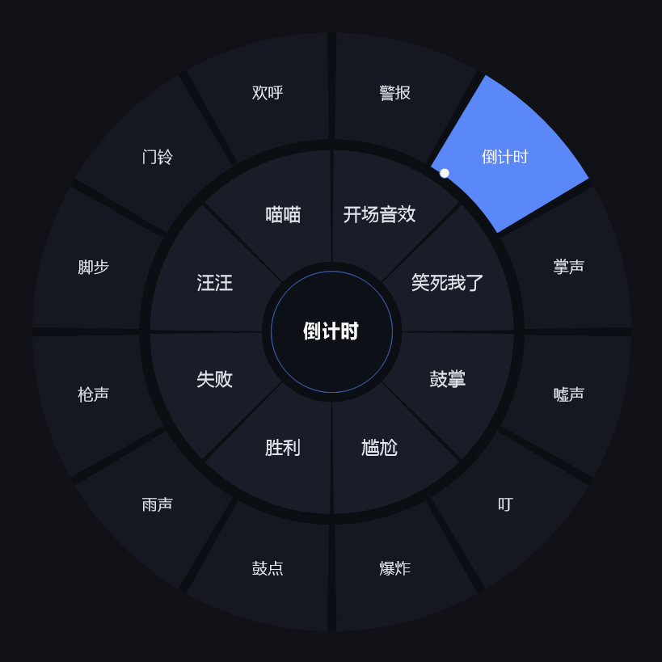
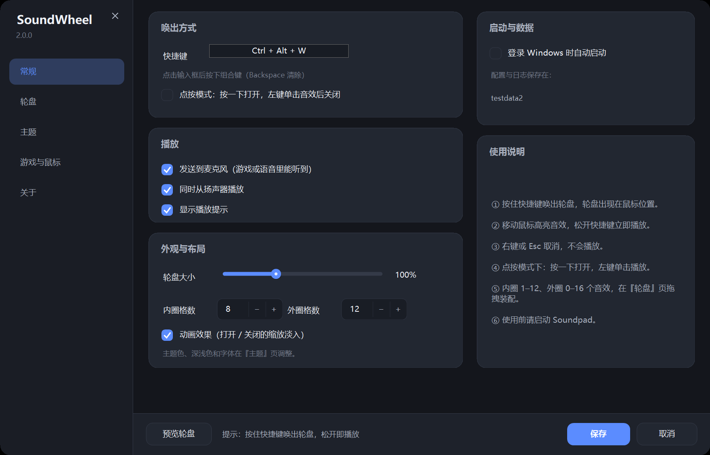
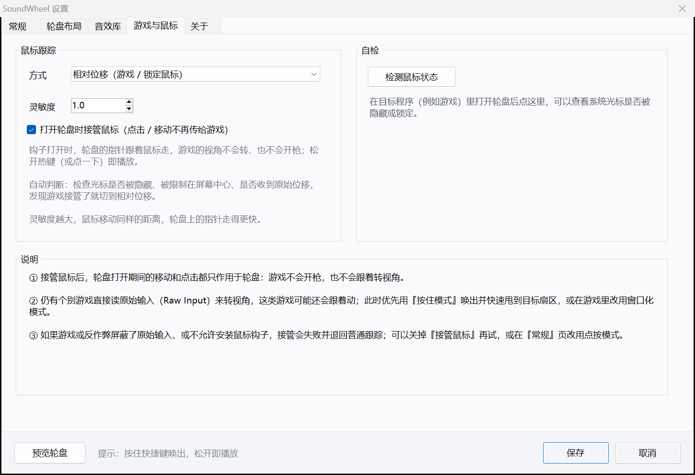

# SoundWheel — a sound wheel for Soundpad

[](LICENSE)
[](AI-DISCLOSURE.md)
[](#requirements)

> [!IMPORTANT]
> **AI-generated project.** Almost everything here — the C# sources, scripts, docs and the icon — was produced by an **AI coding agent** (DeepSeek Harness, model `deepseek-flash`) in a single session on 2026-11-07. A human supplied the requirements, the test machine and the verification. See **[AI-DISCLOSURE.md](AI-DISCLOSURE.md)** for scope, validation and disclaimers.

[中文说明](README.md)



Hold a hotkey, a ring of sounds appears at the cursor, flick the mouse, release — the sound plays.
The inner ring holds 8 favourites, the outer ring 12 more: 20 sounds without memorising 20 hotkeys.

SoundWheel is a standalone single-file `.exe` (no runtime install). It drives Soundpad through the official
**Remote Control API** (named pipe + text commands), so Soundpad itself is never modified.

---

## Features

- **Hotkey summon** — default `Ctrl + Alt + W`, fully rebindable; the wheel opens at the cursor
- **Two rings** — inner 1–12 slots, outer 0–16 slots, assigned independently
- **Two modes** — hold-to-play (release = play) or click-to-play
- **Cancel with right click / Esc**
- **Mouse capture / FPS friendly** — while the wheel is open a low-level mouse hook takes over the mouse, so the game no longer turns or fires; the mouse is handed back the instant the wheel closes (see [Using it in FPS games](#using-it-in-fps--first-person-games))
- **Hover feedback** — the hovered sector lights up, its name shows in the centre hub, and a small dot marks the pointer
- **Playback target** — microphone only / speakers only / both
- **Tray resident** — open wheel, settings, refresh list, open data folder, quit
- **Appearance** — overall scale 70–160 %, accent colour, slot counts, animations
- **Optional run at login** (per-user `HKCU\...\Run` entry, no admin rights)
- **Optional toast** after playback

---

## Requirements

| Item | Requirement |
| --- | --- |
| OS | Windows 10 / 11 (x64) |
| Soundpad | Installed **and running** |
| Runtime | None — uses the built-in .NET Framework 4.x |
| Privileges | Standard user. If Soundpad runs elevated, run SoundWheel elevated too (UIPI) |

Soundpad's remote control is enabled by default; no option has to be ticked.

---

## Quick start

1. Run `SoundWheel.exe` (download from Releases, or build it yourself with `build.cmd`); a wheel icon appears in the tray
2. Right-click the tray icon → **设置…** (Settings)
3. Go to the **轮盘布局** (Wheel layout) tab → **刷新音效列表** (Refresh) → assign sounds to inner/outer slots → **保存** (Save)
4. Back in your game, hold `Ctrl + Alt + W`, move to a sector, release



> The UI is currently Chinese-only. The five tabs are: General · Wheel layout · Sound library · Game & mouse · About.
> Bottom bar: **Preview wheel** · **Save** · **Cancel**.

---

## Using it in FPS / first-person games

Many first-person games **hide the system cursor**, **lock the pointer to the middle of the screen** (`ClipCursor`)
and rotate the camera from raw input. With a plain "read the cursor position" wheel you would not only fail to pick a
sector — the mouse would still be driving the game: one twitch turns the camera, one click fires.

Since 1.2 SoundWheel therefore **takes the mouse over while the wheel is open**:

- a low-level mouse hook (`WH_MOUSE_LL`) **swallows movement, clicks and the wheel** instead of passing them to the game,
  and feeds them to the virtual pointer inside the wheel;
- releasing the hotkey (hold mode) or left-clicking a sector (click mode) plays the sound and **hands the mouse straight back**;
  right click / Esc cancel and release it as well;
- this only lasts the few hundred milliseconds the wheel is up.

The switch is 设置 → **游戏与鼠标** → **打开轮盘时接管鼠标** (on by default).

- **Tracking mode** (same page)
  - **Auto** (default) — after opening, checks whether the cursor is hidden, clipped to the screen centre, or whether
    raw movement arrives, and switches to relative movement when the game is in control
  - **Absolute** — cursor position only (ordinary desktop apps)
  - **Relative** — raw deltas only (that is what capture uses anyway)
- **Sensitivity** 0.2–4.0 — the virtual pointer travels further per mouse count
- **Self-check** — press **检测鼠标状态** while the wheel is open in the game to see whether the cursor is hidden or clipped



Trade-offs:

1. Capture relies on the system low-level mouse hook. If the game runs **as administrator** (higher integrity than this
   app) the hook receives no events and the app degrades to "follow the real cursor", with a warning in the log; run the
   game windowed/borderless or at the same privilege level.
2. A few games read raw input directly; the hook cannot stop those from turning a little — prefer the **hold mode**
   (hold hotkey → flick to the sector → release).
3. Under **exclusive fullscreen** Windows does not allow any ordinary window on top of the game, so the wheel is invisible.
   Use **windowed** or **borderless fullscreen** — the same prerequisite as every overlay tool (Discord, Steam, OBS).

---

## How it works

- **Playback** — Soundpad ships no plugin SDK; its official extension point is the **Remote Control API**:
  named pipe `\\.\pipe\sp_remote_control`, message mode, UTF-8 text commands such as
  `DoPlaySound(3, true, true)` and `GetSoundlist()`, answered with `R-200` and an XML sound list.
- **Wheel** — a borderless layered window rendered into a 32bpp premultiplied bitmap via `UpdateLayeredWindow`
  (per-pixel transparency + antialiasing), covering only the wheel's bounding box, with
  `WS_EX_NOACTIVATE | TOOLWINDOW | TOPMOST` so it never steals focus from the game.
- **DPI** — Per-Monitor V2 aware; all geometry scaled by the monitor DPI (100 %/150 %/200 %).
- **Hotkey** — `RegisterHotKey` + `MOD_NOREPEAT`; "is it still held?" is polled with `GetAsyncKeyState`
  (15 ms) with a 120 ms grace period and a 6 px dead zone, so the wheel never plays something by accident.
- **Mouse capture** — a `WH_MOUSE_LL` hook is installed while the wheel is open; the callback returns 1 for movement,
  clicks and wheel events (so the game never sees them) and feeds the deltas to the virtual pointer. The hook is removed
  the moment the wheel closes. Every frame `SetCursorPos` moves the real cursor onto the virtual pointer (with a hook
  `ResetBase()` so the program's own move is not counted as user input), which is why the pointer is visible on screen.
- **Raw input** — another hidden window registers `RegisterRawInputDevices` (`RIDEV_INPUTSINK`) and turns `WM_INPUT`
  `lLastX/lLastY` into the virtual pointer as a backup source. That window must **not** carry `WS_EX_NOACTIVATE` — with
  that style it receives no `WM_INPUT` at all (measured on Windows 11), so it lives in its own window without the style.
  The virtual pointer is clamped to the outermost ring radius so it can always hit a sector.
- **Drawing** — flat single-colour sectors over one dark base disc (which hides the seams between sectors); the centre
  hub only shows the hovered sound name, and the pointer dot is drawn outside the hub.
- **Drift-proof slots** — each slot stores `title` + `index`; on play the title is resolved against the live
  sound list and only falls back to the stored index.

---

## Data & configuration

Default folder: `%APPDATA%\SoundWheel\`

| File | Purpose |
| --- | --- |
| `config.json` | hotkey, slot assignments, appearance, playback options |
| `sounds.json` | cache of the last sound list read from Soundpad |
| `soundwheel.log` | runtime log — check this first when troubleshooting |

Override with `--data <dir>` or the `SOUNDWHEEL_DATA` environment variable (portable use).
If `%APPDATA%` is not writable the app falls back to `%LOCALAPPDATA%\SoundWheel` → `<exe dir>\SoundWheelData`
→ `%TEMP%\SoundWheel`, and states the chosen folder in the first log line.

---

## Command line

```
SoundWheel.exe [--data <dir>] [--preview [seconds]] [--settings] [--debug-keys] [--debug-mouse]
```

| Option | Meaning |
| --- | --- |
| `--preview [seconds]` | Skip the hotkey, open the wheel in the screen centre (default 6 s) — handy for screenshots |
| `--settings` | Open the settings window directly |
| `--data <dir>` | Data folder (takes precedence over `SOUNDWHEEL_DATA`) |
| `--debug-keys` | Log raw key states (diagnose hold/release problems) |
| `--debug-mouse` | Log every raw mouse delta and tracking-mode switch (diagnose a frozen pointer in games) |

Only one instance may run at a time.

---

## Build

No Visual Studio / .NET SDK needed — only the C# 5 compiler bundled with the .NET Framework:

```cmd
build.cmd
```

Outputs `dist\SoundWheel.exe` (single file, icon embedded) and `dist\MockSoundpad.exe` (a fake Soundpad for
development). A PowerShell equivalent exists as `build.ps1` (requires
`Set-ExecutionPolicy -Scope Process Bypass`).

**Language constraint:** the build must stay C# 5 compatible — no string interpolation, `?.`, `nameof`,
expression-bodied members, tuples, `out var` or auto-property initialisers.

---

## Self-test without Soundpad

```cmd
start dist\MockSoundpad.exe --log %TEMP%\mock.log
start dist\SoundWheel.exe --data examples\testdata
```

`MockSoundpad` serves the same named pipe with 20 fake sounds and logs `PLAY n` for every play command.
A ready-made example configuration is included in `examples\testdata`.

---

## Troubleshooting

- **Hotkey does nothing** — another app owns it (OBS, IME, GPU drivers…); pick another combo.
  Or the foreground app is elevated while SoundWheel is not (match the privilege level).
- **Wheel says "click to play" instead of "release to play"** — the key state could not be read in this
  environment (RDP, exclusive fullscreen, input-hooked games). The wheel automatically degrades to
  click-to-play, so it never gets stuck.
- **Nothing audible** — is Soundpad running? Refresh the sound list; check `soundwheel.log`;
  check the "send to microphone" option and Soundpad's own device settings.
- **Wrong sound plays** — the order changed inside Soundpad; refresh the list (matching is title-first).
- **Wheel opens in a game but the pointer will not move** — Settings → **Game & mouse** → **检测鼠标状态** to see
  whether the cursor is hidden or clipped; switch tracking to **Relative**; try windowed/borderless mode; run with
  `--debug-mouse` and check the log for the "no hook events" / "no raw input within 1.6 s" warnings.
- **Mouse captured but the camera still turns** — a few games read raw input directly; use hold mode, or run the game
  windowed. If the log says no hook events arrived, the game is running at a higher integrity level than SoundWheel.

---

## Known limitations

- Only the **All sounds** category index is used (that is what the Remote Control API exposes)
- Max 12 inner + 16 outer slots, one configuration at a time
- Mouse capture relies on `WH_MOUSE_LL`; a higher-integrity foreground app (elevated game) means the hook gets no
  events and the app degrades to following the real cursor
- A few games read raw input directly and still turn; under exclusive fullscreen the wheel cannot be shown at all
- The pointer is derived from hook events / cursor position, so a badly stuttering game may lag it by a frame or two
- Playback/stop only — it never edits audio or Soundpad's own data
- UI is Chinese-only; tested on Windows 11 at 150 % DPI

---

## Contributing

Read [CONTRIBUTING.md](CONTRIBUTING.md) first. The two rules that matter: keep it **C# 5** and never commit
`dist/`. By submitting a PR you agree to license your contribution under MIT. Be kind:
[CODE_OF_CONDUCT.md](CODE_OF_CONDUCT.md). Security issues: [SECURITY.md](SECURITY.md).

## License

[MIT](LICENSE). Because most of this repository is AI-generated, copyright may not subsist in every
jurisdiction; the MIT grant applies to the extent such rights exist. Full disclosure:
[AI-DISCLOSURE.md](AI-DISCLOSURE.md).

SoundWheel is an unofficial third-party tool, not affiliated with or endorsed by Leppsoft / Soundpad.
Soundpad is a trademark of its respective owner.

Provided **as is**, without warranty of any kind.
