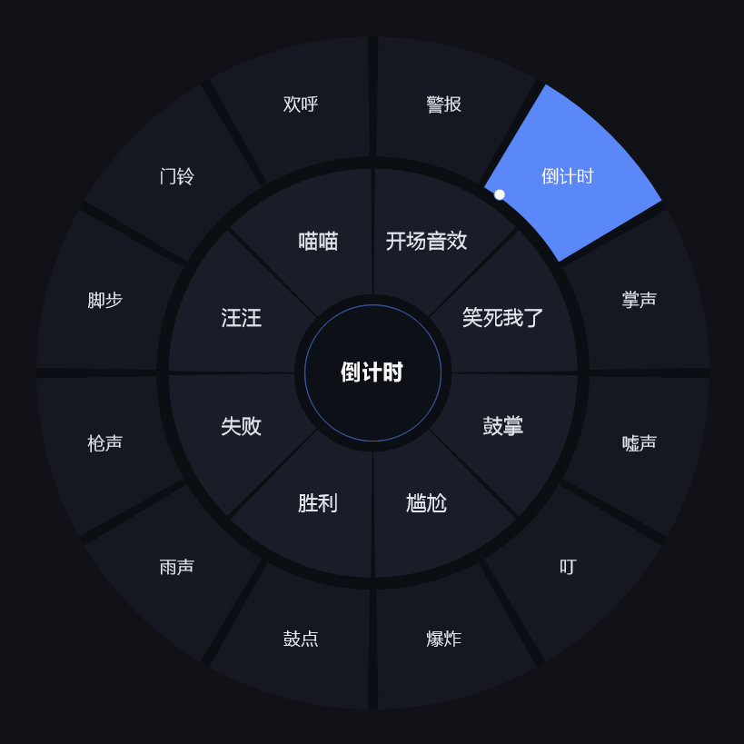
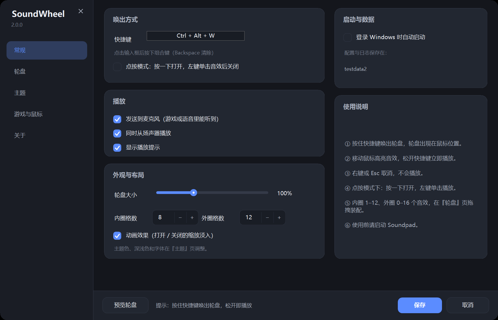
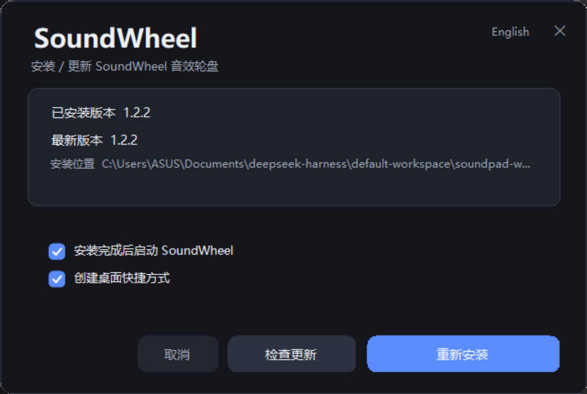
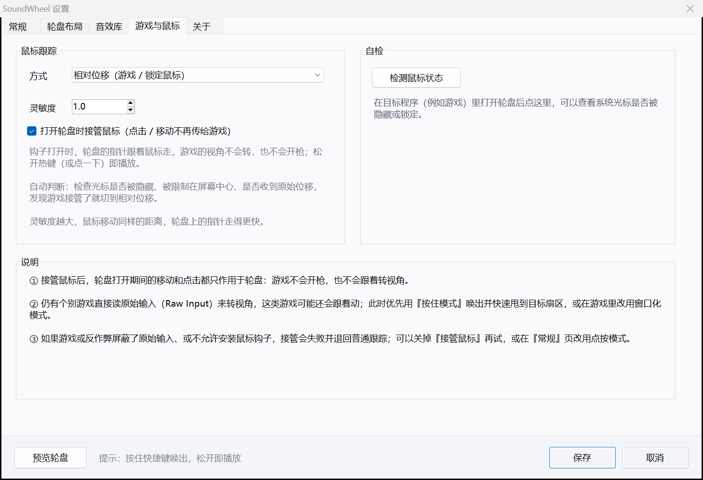
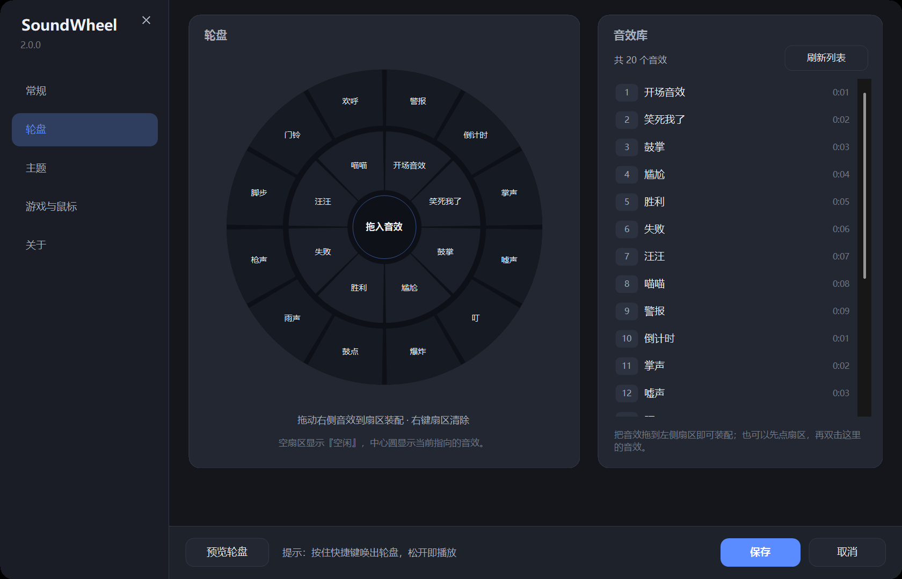
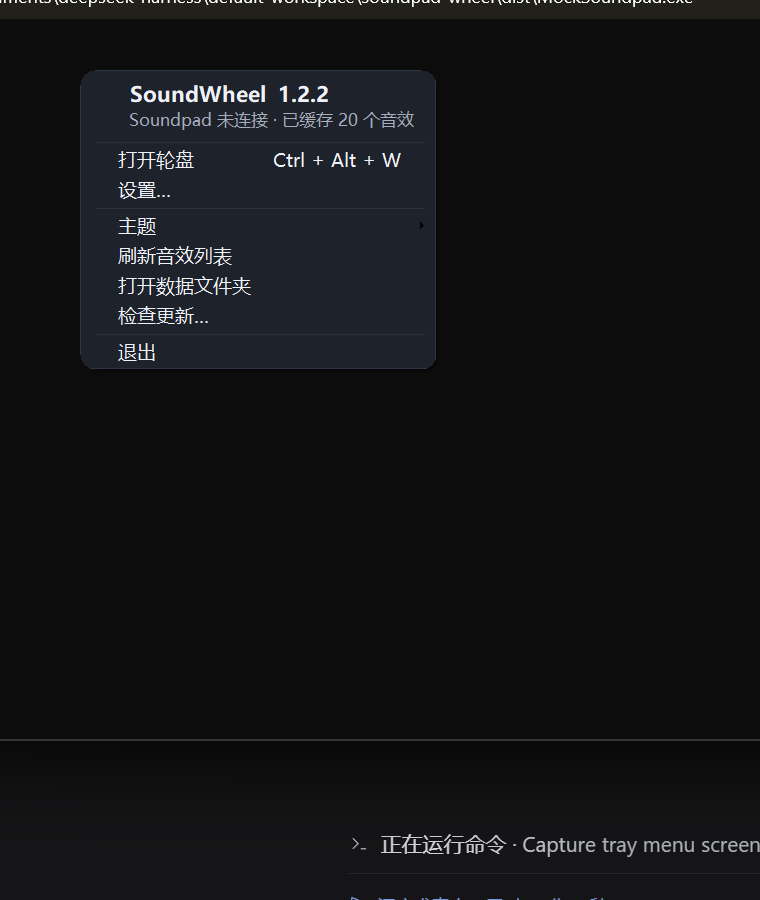

# SoundWheel — Soundpad 音效轮盘

[](LICENSE)
[](AI-DISCLOSURE.md)
[](#系统要求)
[](CHANGELOG.md)
[](https://github.com/Focold/soundpad-wheel/actions/workflows/build.yml)

> [!IMPORTANT]
> **AI 生成声明**：本项目的代码、脚本、文档与图标几乎全部由 **AI 编码代理**（DeepSeek Harness，模型 `deepseek-flash`）在 2026-11-07 的单次会话中生成，人类负责提出需求、提供测试环境与验证结果。
> 详细说明、验证范围与免责条款见 **[AI-DISCLOSURE.md](AI-DISCLOSURE.md)**。

📖 [English version](README.en.md) · [更新日志](CHANGELOG.md) · [贡献指南](CONTRIBUTING.md) · [安全策略](SECURITY.md) · [行为准则](CODE_OF_CONDUCT.md) · [许可](LICENSE)



按住一个热键，屏幕中心（光标处）弹出一圈音效；鼠标一甩、手指一松，音效就播出去了。
内圈放常用的 8 个，外圈再挂 12 个，一共 20 个音效不用记快捷键。

SoundWheel 是一个独立的小程序（单文件 exe，无需安装运行时），它通过 **Soundpad 官方的 Remote Control API** 控制 Soundpad 播放指定音效，因此不会修改 Soundpad 本体，也不会影响它的任何设置。

---

## 功能一览

- **热键唤出**：默认 `Ctrl + Alt + W`，可改成任意组合键；轮盘出现在鼠标位置
- **内外双环**：内圈 1–12 格，外圈 0–16 格，两圈独立分配
- **两种操作方式**
  - 按住模式：按住热键 → 移动鼠标选中 → 松开即播放
  - 点按模式：按一下打开 → 左键点击扇区播放 → 自动关闭
- **右键 / Esc 取消**，取消不会播放
- **接管鼠标 / 兼容 FPS**：轮盘打开时用低级鼠标钩子接管鼠标，游戏不再转视角、不会误触开枪；关掉轮盘立刻归还（见 [在 FPS / 第一人称游戏里使用](#在-fps--第一人称游戏里使用)）
- **悬停反馈**：高亮所在扇区，中心显示音效名称，指针位置有小白点
- **播放目标可配**：只发麦克风 / 只走扬声器 / 两者同时（Soundpad 侧需要在"麦克风"设备上正常工作）
- **托盘常驻**：托盘菜单可打开轮盘、改设置、刷新列表、打开数据目录、退出
- **外观可调**：整体大小 70%–160%、字体缩放 85%–135%、内外圈格数、开关打开/关闭动画
- **深色 / 浅色主题**：跟随系统 / 强制深色 / 强制浅色，12 种预设主题色 + 任意自定义颜色（轮盘、设置窗口、托盘菜单同步换色）
- **拖拽装配**：设置里的「轮盘」页左边是轮盘预览、右边是音效库，把音效拖到扇区即可装配；也可以先点扇区再双击音效
- **安装向导**（2.0 新增）：中文 / English 双语、免管理员装到 `%LOCALAPPDATA%\SoundWheel`、可从 GitHub 检查最新版并更新、可重新安装或卸载
- **登录时自动启动**（写 HKCU 的 Run 项，不需要管理员权限）
- **播放提示条**（可选）：播放时在光标下方弹出一个小药丸提示

---

## 系统要求

| 项目 | 要求 |
| --- | --- |
| 操作系统 | Windows 10 / 11（64 位） |
| Soundpad | 已安装并**正在运行**（Steam 版或独立版均可） |
| 运行时 | 不需要额外安装 —— 使用系统自带的 .NET Framework 4.x（Win10/11 自带 4.8） |
| 权限 | 普通用户即可。若 Soundpad 以管理员身份运行，本程序也要以管理员身份运行（Windows 的 UIPI 限制） |

> Soundpad 的远程控制默认就是开启的，不用在它里面勾任何选项，只要它正在运行即可。

---

## 快速开始

1. 从 [Releases](https://github.com/Focold/soundpad-wheel/releases) 下载 **`SoundWheelSetup.exe`** 并运行，跟着向导点"安装"（详见下面的[安装与更新](#安装与更新)）；也可以下载单文件 `SoundWheel.exe` 直接运行
2. 首次启动会在托盘显示一个轮盘小图标，右键 → **设置…**
3. 切到 **轮盘** 页 → 点 **刷新音效列表** → 把右边的音效**拖到**左边轮盘的扇区上（或先点扇区、再双击音效）→ **保存**
4. 回到游戏或语音软件，按住 `Ctrl + Alt + W`，鼠标移到想要的扇区，松开



---

## 安装与更新

**安装**：运行 `SoundWheelSetup.exe`，向导会自动读取电脑上已安装的版本和 GitHub 上的最新版本：

- 免管理员权限，默认装到 `%LOCALAPPDATA%\SoundWheel`（可用 `--dir <目录>` 指定别处）
- 可选 **安装完成后启动**、**创建桌面快捷方式**；开始菜单快捷方式总会创建
- 已安装且已是最新版本时，向导会先提示"当前已是最新版本 X。是否重新安装？"，确认后才覆盖安装
- 右上角可随时在 **中文 / English** 之间切换
- 卸载：Windows「设置 → 应用」里的 SoundWheel，或 `SoundWheelSetup.exe --uninstall`；卸载时可勾选"同时删除配置与日志"

**更新**（三条路径，都从 [GitHub Releases](https://github.com/Focold/soundpad-wheel/releases) 获取）：

| 入口 | 行为 |
| --- | --- |
| 安装向导 | 打开时自动检查最新版本；发现新版时主按钮变成 **下载并更新**，下载 `SoundWheelSetup.exe` 后静默安装到同一目录 |
| 设置 → 关于 | **检查更新** / **下载并安装** 按钮 |
| 程序启动时（静默） | 后台检查一次，有新版本时弹托盘气泡提示，点击打开下载页；设 `SOUNDWHEEL_NO_UPDATE_CHECK=1` 可关闭 |

安装/更新都会**自动关闭正在运行的旧版本**（托盘图标消失是正常的），并且**保留 `%APPDATA%\SoundWheel` 里的配置**。



**静默命令行**（给脚本或批量部署用）：

```cmd
SoundWheelSetup.exe /S --dir "%LOCALAPPDATA%\SoundWheel"
SoundWheelSetup.exe /S --uninstall
```

---

## 使用方式

| 操作 | 效果 |
| --- | --- |
| 按住热键 | 轮盘在光标处打开，中心显示"选择音效 / 移动鼠标" |
| 移动鼠标 | 高亮所在扇区，中心显示该音效名称；移到空白格显示"空闲位置" |
| 松开热键 | 播放当前高亮的音效，然后关闭（中心圆形区域不播放） |
| 右键 / Esc | 取消，不播放 |
| 轮盘打开期间 | 鼠标被轮盘接管（默认），移动/点击不会传给游戏；关闭后立即恢复 |
| 点按模式：左键点击扇区 | 播放该音效并关闭 |
| 点按模式：15 秒无操作 | 自动关闭 |

---

## 在 FPS / 第一人称游戏里使用

很多第一人称游戏会 **隐藏系统光标**、把鼠标指针 **锁在屏幕中央**（`ClipCursor`），再用原始输入（Raw Input）转动视角。这时候用普通"读光标位置"的方式，不只是选不中扇区 —— 鼠标还在控制游戏，移一下就转视角，点一下就开枪。

所以从 1.2 开始，SoundWheel 会在 **轮盘打开的那段时间里接管鼠标**：

- 用低级鼠标钩子（`WH_MOUSE_LL`）把移动、左右键、滚轮 **拦下来不再传给游戏**，只拿来推动轮盘里的指针；
- 松开热键（按住模式）或左键点中扇区（点按模式）就播放，并 **立刻把鼠标还给游戏**；右键 / Esc 取消同样立刻放开；
- 只在这几百毫秒内生效，轮盘一关鼠标马上恢复原状。

开关在 设置 → **游戏与鼠标** → **打开轮盘时接管鼠标**（默认开启）。

- **跟踪方式**（同一个页面）
  - **自动判断**（默认）：打开轮盘后检测光标是否被隐藏 / 被限制在屏幕中心 / 是否收到原始位移，发现游戏接管了鼠标就自动改用相对位移
  - **绝对坐标**：只用光标位置（普通桌面程序）
  - **相对位移**：只用原始位移（接管鼠标时就是这种方式）
- **灵敏度** 0.2–4.0：调大后鼠标移动同样的距离，轮盘里的指针走得更快
- **自检**：在目标程序（例如游戏）里打开轮盘后点 **检测鼠标状态**，可以直接看到"光标是否隐藏 / 裁剪矩形 / 是否被锁定"



需要注意的取舍：

1. 接管依赖系统的低级鼠标钩子。如果前台的游戏 **以管理员身份运行**（权限比本程序高），钩子收不到事件，程序会退化成"跟着真实光标走"，日志里会写一行告警；此时把游戏改成窗口化 / 无边框，或让游戏与本程序权限一致（都不提权）即可。
2. 少数游戏直接读原始输入来转视角，即使系统消息被拦下也可能跟着转；这种情况建议用 **按住模式**（按住热键 → 甩到目标扇区 → 松开），轮盘关闭后视角才恢复。
3. **窗口化 / 无边框全屏**（Borderless）游戏会把自己压在其他窗口上面。从 1.2.2 起，轮盘打开时会把窗口顶到最前，并在打开期间周期性重新置顶（默认每 250ms），被盖住时立即补一次，所以无边框全屏也能稳定显示。
4. **独占全屏**（Exclusive Fullscreen）是另一回事：系统不允许任何普通窗口画在游戏画面上，轮盘依然看不到；请把游戏改成 **窗口化** 或 **无边框全屏** —— 这也是所有覆盖层工具（Discord、Steam、OBS）的共同前提。此时日志里会出现"轮盘持续被前台全屏窗口遮挡"的告警。

**关于"自动切换点按模式"**：程序靠轮询按键状态判断"松开了没有"。极少数情况下（远程桌面、独占全屏、被反作弊/输入法/其他输入软件抢占等情况）读不到按键状态，此时轮盘打开约 2.5 秒后会自动切换到点按模式，中心提示会从"松开播放"变成"点击播放"，此时用鼠标左键点选即可 —— 功能不会被卡死。

---

## 设置界面

设置窗口是**无边框圆角**窗口：左侧是导航（常规 / 轮盘 / 主题 / 游戏与鼠标 / 关于），右侧是内容卡片，底部固定 **预览轮盘**、**保存**、**取消**；标题栏可拖动，Esc 关闭。

| 页 | 内容 |
| --- | --- |
| **常规** | 快捷键（点输入框后按下组合键，Backspace 清除）、点按模式、播放目标（麦克风 / 扬声器 / 播放提示）、轮盘大小、内外圈格数、动画开关、登录时自动启动、配置路径、使用说明 |
| **轮盘** | 左边是**可交互的轮盘预览**，右边是**音效库**：把音效从库里**拖到**扇区即可装配；也可以先点扇区选中、再双击音效。右键扇区清除该槽位，中心圆显示当前指向的音效 |
| **主题** | 外观模式（跟随系统 / 深色 / 浅色）、12 种预设主题色 + 自定义颜色、界面字体缩放 85%–135%，右侧实时预览轮盘配色 |
| **游戏与鼠标** | 是否接管鼠标（默认开）、鼠标跟踪方式（自动判断 / 绝对坐标 / 相对位移）、灵敏度、鼠标状态自检、FPS 使用说明 |
| **关于** | 版本、**检查更新 / 下载并安装**、数据目录、仓库链接 |

主题色会同时作用于轮盘、设置窗口和托盘菜单；保存后立即生效（下次打开轮盘就是新配色）。



---

## 数据与配置

默认位置：`%APPDATA%\SoundWheel\`

| 文件 | 说明 |
| --- | --- |
| `config.json` | 热键、内外圈分配、外观、播放选项 |
| `sounds.json` | 最近一次从 Soundpad 读到的音效列表缓存（启动时先用它，连上后自动刷新） |
| `soundwheel.log` | 运行日志（排查问题时看这个） |

可用 `--data <目录>` 参数或环境变量 `SOUNDWHEEL_DATA` 覆盖数据目录（例如做成绿色版放在 U 盘里）。

如果 `%APPDATA%` 不可写（受限账户、漫游配置被策略锁定等），程序会依次回退到 `%LOCALAPPDATA%\SoundWheel` → `程序目录\SoundWheelData` → 临时目录，并在日志第一行写明实际使用的目录，而不是直接报错退出。

**抗索引漂移**：每个槽位同时保存 `title` 和 `index`。播放时优先在当前音效列表里按标题重新定位真实索引，找不到才退回保存的索引 —— 所以你在 Soundpad 里增删音效后，通常不需要重新配置。

---

## 命令行参数

```
SoundWheel.exe [--data <目录>] [--preview [秒]] [--settings] [--debug-keys] [--debug-mouse]
```

| 参数 | 说明 |
| --- | --- |
| `--preview [秒]` | 不注册热键，直接在屏幕中心打开轮盘做预览（默认 6 秒），适合截图/检查外观 |
| `--settings` | 直接打开设置窗口（不起托盘、不注册热键） |
| `--data <目录>` | 指定数据目录（优先级高于 `SOUNDWHEEL_DATA`） |
| `--debug-keys` | 把按键原始状态写进日志（排查"按住/松开"不生效时使用） |
| `--debug-mouse` | 把每条原始鼠标位移、跟踪模式切换写进日志（排查 FPS 里指针不动时使用） |

环境变量：

- `SOUNDWHEEL_TOPMOST_MS`：轮盘打开期间重新置顶的间隔（毫秒，默认 `250`；`0` 表示只在打开时置顶一次、不做周期重试）
- `SOUNDWHEEL_NO_UPDATE_CHECK=1`：关闭启动时的静默更新检查
- `SOUNDWHEEL_DEBUG_MOUSE=1` / `SOUNDWHEEL_DEBUG_KEYS=1`：等价于对应的命令行开关

单实例：同一时间只允许一个 SoundWheel 进程，重复启动会提示"SoundWheel 已经在运行，请在系统托盘中查看。"

---

## 托盘菜单

2.0 起托盘菜单是**自绘的圆角深色 / 浅色菜单**，会跟随主题换色，并在顶部显示版本、Soundpad 连接状态与当前快捷键：

**打开轮盘** · **设置…** · **主题**（跟随系统 / 深色 / 浅色 + 12 个主题色） · **刷新音效列表** · **打开数据文件夹** · **检查更新…** · **退出**

（双击托盘图标 = 打开轮盘）



---

## 构建

不需要 Visual Studio / .NET SDK，只用到系统自带的 .NET Framework 4.x 编译器（C# 5）。

```
build.cmd
```

输出：

- `dist\SoundWheel.exe` —— 主程序（带图标，单文件，无外部依赖）
- `dist\SoundWheelSetup.exe` —— 安装向导（把主程序作为资源内嵌，单文件；中英双语、可检查更新 / 卸载）
- `dist\MockSoundpad.exe` —— 开发用的假 Soundpad（见下）

等价 PowerShell 脚本 `build.ps1` 也可以，但需要允许脚本执行：

```powershell
Set-ExecutionPolicy -Scope Process Bypass -Force
.\build.ps1
```

源码结构：

| 文件 | 职责 |
| --- | --- |
| `src\Program.cs` | 入口、DPI 感知、命令行解析、单实例、预览/设置模式 |
| `src\App.cs` | 托盘、热键注册、播放调度、Soundpad 重连、开机自启、退出清理 |
| `src\WheelWindow.cs` | 轮盘窗口：分层窗口绘制、扇区几何、命中测试、动画、提交逻辑 |
| `src\SettingsForm.cs` | 设置窗口：圆角无边框外壳、左侧导航、五个页面、实时主题切换 |
| `src\WheelPreview.cs` | 设置里的可交互轮盘预览：点击选槽、右键清除、拖放装配 |
| `src\Theme.cs` | 深色 / 浅色配色与 12 种主题色、系统主题检测 |
| `src\Ui.cs` | 自绘控件：圆角按钮 / 卡片 / 复选框 / 色块 / 分段控件 / 滑杆 / 数字框 |
| `src\TrayMenu.cs` | 自绘托盘菜单（圆角、主题跟随、主题子菜单、检查更新） |
| `src\Update.cs` | GitHub Releases 版本检查与下载 |
| `installer\Setup.cs` / `installer\SetupUi.cs` | 安装 / 卸载逻辑、快捷方式与注册表登记、双语向导界面 |
| `src\MouseHook.cs` | 低级鼠标钩子（`WH_MOUSE_LL`）：轮盘打开期间接管鼠标，吞掉移动/点击/滚轮 |
| `src\RawMouse.cs` | 接收 Raw Input 的隐藏窗口（相对位移输入的备用来源） |
| `src\SoundpadClient.cs` | 命名管道客户端、`GetSoundlist` / `DoPlaySound` 命令、音效缓存 |
| `src\Hotkey.cs` | 热键数据结构、组合键显示名、热键输入框控件 |
| `src\Config.cs` | 配置模型（槽位、外观、播放选项）、JSON 读写、颜色工具 |
| `src\Json.cs` | 极简 JSON 解析/序列化（不引用外部库） |
| `src\Native.cs` | Win32 P/Invoke（热键、分层窗口、DPI、鼠标、管道） |
| `src\Toast.cs` | 播放提示条窗口 |
| `src\Log.cs` / `src\Paths.cs` | 日志与路径 |

---

## 开发自测：MockSoundpad

`dist\MockSoundpad.exe` 会模拟 Soundpad 的命名管道（`\\.\pipe\sp_remote_control`），返回 20 条假音效：

- `--log <文件>` 指定日志（默认 `%TEMP%\soundwheel-mock.log`），每次收到播放命令会写一行 `PLAY n`
- 配合 `--data examples\testdata` 这样的独立数据目录，就能在没有 Soundpad 的机器上完整验证：读列表、分配、播放、日志

```cmd
start dist\MockSoundpad.exe --log %TEMP%\mock.log
start dist\SoundWheel.exe --data examples\testdata
```

仓库里已附带一份 20 个假音效的示例配置（`examples\testdata\config.json`），内外圈都分配好了，开箱即可点着玩。

---

## 工作原理（简述）

- **播放**：Soundpad 没有提供插件 SDK，官方扩展点是 **Remote Control API** —— 命名管道 `\\.\pipe\sp_remote_control`，消息模式（message mode），UTF-8 文本命令，形如 `DoPlaySound(3, true, true)`、`GetSoundlist()`，返回如 `R-200` 或 XML 音效列表。SoundWheel 就是一个这样的客户端（也可用 `Soundpad.exe -rc <命令>` 手动验证）。
- **轮盘**：无边框分层窗口 + 32bpp 预乘位图 `UpdateLayeredWindow`，实现逐像素透明和抗锯齿；窗口只覆盖轮盘包围盒（不是全屏），并带 `WS_EX_NOACTIVATE | TOOLWINDOW | TOPMOST`，不会抢走游戏焦点。
- **DPI**：进程启用 Per-Monitor V2，所有几何按显示器 DPI 手动换算，150% / 200% 缩放下不会糊也不会错位。
- **热键**：`RegisterHotKey` + `MOD_NOREPEAT`；"是否还按着"用 `GetAsyncKeyState` 轮询（15ms），带 120ms 宽限与 6px 死区，避免"按下瞬间误播"。
- **接管鼠标**：轮盘打开期间装一个 `WH_MOUSE_LL` 低级鼠标钩子，回调里直接 `return 1` 把移动/左右键/滚轮吞掉（不传给游戏），同时把位移喂给虚拟指针；关闭轮盘立刻 `UnhookWindowsHookEx`。每帧用 `SetCursorPos` 把系统光标同步到虚拟指针位置（并 `ResetBase` 防止钩子把这次同步算成一段位移），所以指针在屏幕上也是真实可见的。
- **原始输入**：另有一个不可见窗口注册 `RegisterRawInputDevices`（`RIDEV_INPUTSINK`）接收 `WM_INPUT`，作为相对位移的备用来源；它 **不能带 `WS_EX_NOACTIVATE`** —— 实测带这个样式就收不到 `WM_INPUT`，所以它单独用一个不带该样式的窗口。虚拟指针被限制在最外圈半径内，避免越界后无法悬停。
- **绘制**：扇区为整块平涂 + 一块深色底盘填掉扇区间缝隙；中心圆只显示当前音效名，指针点画在底盘之上、中心圆之外。

---

## 故障排查

**热键按了没反应**
- 热键被别的程序占用（OBS、输入法、显卡驱动、Office 等）→ 设置里换一个组合键
- 前台程序以管理员权限运行，而本程序不是 → 让两者权限一致（都用管理员，或都不用）
- 看 `soundwheel.log` 里有没有 `热键已注册 ...` / `收到 WM_HOTKEY ...`

**轮盘出现了，但中心显示"点击播放"**
- 环境读不到按键状态，已自动降级为点按模式，用左键点选即可；如需排查可加 `--debug-keys` 看日志

**能打开，点击/松开后没有声音**
- 确认 Soundpad 正在运行；托盘 → 刷新音效列表，看音效库页是否有内容
- 看 `soundwheel.log` 里是否有 `播放失败` / `连接` 相关记录
- 语音软件里听不到 → 检查本程序是否勾选"发送到麦克风"，以及 Soundpad 的麦克风设备设置

**在游戏里能看到鼠标动了，但轮盘根本不出现 / 被游戏挡住**
- 1.2.2 起会自动把轮盘重新提到最前面；如果仍然看不到，看 `soundwheel.log` 里是否有 `轮盘已置顶 前台全屏=...` 与 `轮盘持续被前台全屏窗口遮挡` 的告警
- 这条告警基本说明游戏用的是 **独占全屏**：改成 **窗口化** 或 **无边框全屏**（这也是 Discord / Steam / OBS 覆盖层的共同前提）
- 想手动控制置顶频率：环境变量 `SOUNDWHEEL_TOPMOST_MS`（默认 250 毫秒，`0` 关闭周期性置顶）

**在游戏里轮盘能打开，但指针不动 / 选不中**
- 打开 设置 → **游戏与鼠标** → 点 **检测鼠标状态**，看光标是否被隐藏或锁定
- 跟踪方式改成 **相对位移** 再试；仍不动的话，把游戏改成窗口化 / 无边框模式
- 加 `--debug-mouse` 启动，日志里会写跟踪模式、原始位移、以及"1.6 秒内没有收到鼠标原始输入"的告警
- 反作弊把原始输入完全屏蔽时无解，退化为点按模式或绝对坐标

**播放了错的声音**
- Soundpad 里音效顺序变了 → 托盘 刷新音效列表，或重新保存一次布局（按标题重新匹配）

**连接 Soundpad 失败**
- 必须让 Soundpad 先启动；若 Soundpad 卡死，重启它
- Soundpad 的远程控制日志在它的数据目录里（`%APPDATA%\Soundpad\...`），对照本程序日志里的命令即可确认

---

## 已知限制

- 只使用 Soundpad **All sounds** 分类的序号（这是 Remote Control API 的索引定义），不支持直接引用其他分类
- 内圈最多 12 格、外圈最多 16 格
- 接管鼠标依赖 `WH_MOUSE_LL`：前台程序权限更高（例如游戏以管理员运行）时钩子收不到事件，会退化成跟随真实光标
- 个别游戏直接读原始输入转视角，钩子拦不住
- 独占全屏（Exclusive Fullscreen）下轮盘无法显示在游戏画面上，请改用窗口化 / 无边框全屏（程序会自动周期性置顶，兼容无边框全屏游戏）
- 指针位置按钩子事件 / 光标位置推算，极端卡顿时可能有 1–2 帧延迟
- 同一时间只有一个配置（没有多套轮盘/多套配置文件）
- 安装向导不做代码签名，首次运行 Windows SmartScreen 可能提示"更多信息 → 仍要运行"
- 自动更新依赖 GitHub Releases，需要能访问 github.com 与 api.github.com
- 只做"播放/停止"，不修改 Soundpad 本身、不做音频编辑
- 仅在 Windows 10/11 上测试

---

## 仓库结构

```
SoundWheel/
├─ src/            主程序源码（20 个 .cs，C# 5）
├─ installer/      安装 / 卸载向导（Setup.cs + SetupUi.cs，编译为 SoundWheelSetup.exe）
├─ tools/          MockSoundpad 假服务器、图标生成器、开发期探针
├─ assets/         图标与文档截图
├─ examples/       示例数据目录（可直接 --data 使用）
├─ .github/        issue 模板、PR 模板、CI 工作流
├─ build.cmd       一键构建（系统自带 csc，无需 SDK；同时产出 Setup）
├─ build.ps1       同上（PowerShell 版）
└─ README.md
```

文档索引：`AI-DISCLOSURE.md`（AI 生成声明）· `CHANGELOG.md`（版本记录）· `CONTRIBUTING.md`（开发与提交流程）· `SECURITY.md`（安全边界）· `CODE_OF_CONDUCT.md`（行为准则）· `LICENSE`（MIT）。

---

## 贡献

欢迎 issue 与 PR。提 PR 前请先读 [CONTRIBUTING.md](CONTRIBUTING.md)，其中最重要的两条是：

1. **必须保持 C# 5 语法**（构建用的是 Windows 自带的 csc，不支持 `$""`、`?.`、`nameof`、表达式体成员等）
2. 不要提交 `dist/`、日志与截图

提交即表示你同意以 MIT 许可发布你的贡献。参与本项目请遵守 [行为准则](CODE_OF_CONDUCT.md)。

---

## 许可与致谢

以 [MIT](LICENSE) 许可发布，版权归 "SoundWheel contributors" 所有。

由于本项目内容主要由 AI 生成，各地法律对 AI 生成内容的版权认定不同；MIT 条款在上述权利存在的范围内适用，不额外限制你对这些内容的使用。详见 [AI-DISCLOSURE.md](AI-DISCLOSURE.md)。

SoundWheel 是第三方工具，与 Leppsoft / Soundpad 官方无关联、未获其背书；Soundpad 是其各自权利人的商标。感谢 Soundpad 提供的 Remote Control API。

本项目按"原样"提供，不附带任何担保 —— 打开音效前请先确认场合 🙂
